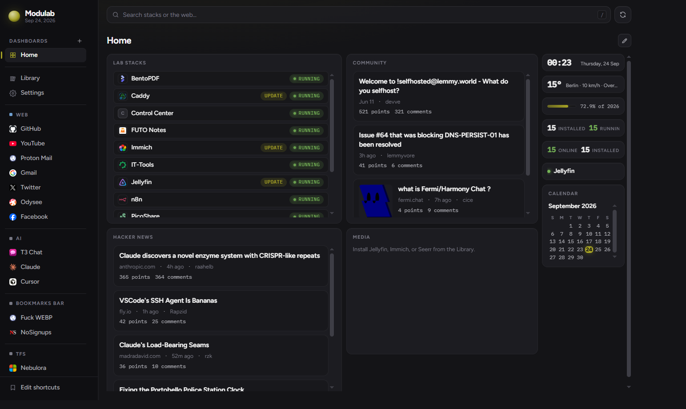
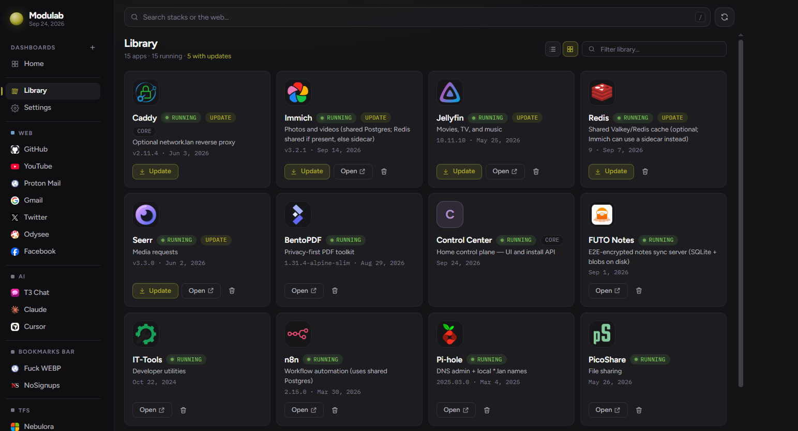

# Modulab — modular homelab stacks

Independent [Docker Compose](https://docs.docker.com/compose/) stacks for a personal lab. Run Control Center (dashboard + install API), shared Postgres, optional Caddy / Pi-hole for `*.network.lan` names, and install apps from a catalog.

## Screenshots

### Home



### Library



---

## Install guide (first time)

**You need:** [Docker Engine](https://docs.docker.com/engine/install/) with Compose v2 (Docker Desktop is fine).  
**You do not need:** a git clone, Python, or Node on the host.

Catalog, scripts, and compose templates ship inside the published image. Your PC only keeps a **state directory** (config + app data).

### Linux / macOS

```bash
# 1. Create a permanent state folder
mkdir -p "$HOME/modulab-data"

# 2. Tell Compose the absolute path to that folder (required)
export MODULAB_HOST_ROOT="$HOME/modulab-data"

# 3. Download the bootstrap file (any working directory is fine)
curl -fsSL -o compose.yaml \
  https://raw.githubusercontent.com/armanossiloko/modulab/master/compose.yaml

# 4. Start Modulab
docker compose up -d
```

### Windows (PowerShell + Docker Desktop)

```powershell
# 1. State folder
New-Item -ItemType Directory -Force -Path "$HOME\modulab-data" | Out-Null

# 2. Absolute path for bind mounts (required)
$env:MODULAB_HOST_ROOT = (Resolve-Path "$HOME\modulab-data").Path

# 3. Bootstrap compose
curl.exe -fsSL -o compose.yaml `
  https://raw.githubusercontent.com/armanossiloko/modulab/master/compose.yaml

# 4. Start
docker compose up -d
```

> Tip: keep `MODULAB_HOST_ROOT` set in the same shell (or your user environment) whenever you run `docker compose` for Modulab.

### Open Control Center and finish setup

1. Wait until the container is healthy (`docker compose ps`). First pull can take a few minutes.
2. Open **http://localhost:8888** (or `http://<this-PC-LAN-IP>:8888` from another device).
3. **Set an admin password.** The first visit asks for one; every later visit needs it.
4. Go to **Settings → Lab**.
5. Set **Host IP** to this machine’s LAN address (not `127.0.0.1`). Example: `192.168.1.50`.
6. Optionally set domain, timezone, passwords, LAN reverse proxy (Caddy), LAN HTTPS, or enable Pi-hole.
7. Click **Save**.

Until Host IP is set, a banner appears and **Library → Install** stays disabled.

### Install apps

1. Open **Library**.
2. Choose an app (e.g. Jellyfin, Immich) → **Install**.
3. Open the app by IP+port or, if Pi-hole + Caddy are configured, by `http://<name>.network.lan`.

Dependencies start automatically. MediaCMS also starts shared Redis. Immich uses shared Redis if it is already running; otherwise it starts its own sidecar Redis.

### What the first boot does

| Step | What happens |
|------|----------------|
| Pull image | `ghcr.io/armanossiloko/modulab:latest` |
| Seed state | Copies catalog, scripts, and compose templates into `MODULAB_HOST_ROOT`; removes recipes a newer image no longer ships |
| Secrets | `"$generate"` values in the example config become random passwords (Postgres, Pi-hole, app secrets) |
| Base stacks | Starts **Postgres** + **Caddy** (default). Redis and Pi-hole stay off until you enable them |
| Control Center | Serves UI + API on port **8888** |

### Day-to-day (appliance)

```bash
export MODULAB_HOST_ROOT="$HOME/modulab-data"   # if not already set
cd /path/to/folder/with/compose.yaml

docker compose ps          # status
docker compose logs -f     # logs
docker compose pull && docker compose up -d   # update Control Center image
docker compose down        # stop Control Center (app containers may keep running)
```

App start/stop/update after the first setup is done in the **Library** UI (or via scripts if you use a contributor checkout).

### Optional: friendly hostnames (`*.network.lan`)

Apps always work via `http://<host-ip>:<port>`. Hostnames need DNS:

1. In **Settings → Lab**, set Host IP and enable **Pi-hole**.
2. Point your router’s DHCP DNS (or each client) at that Host IP.
3. Use URLs like `http://jellyfin.network.lan` (Caddy on port 80).

Details: [pihole/LOCAL-DNS.md](pihole/LOCAL-DNS.md).

### Environment variables

| Variable | Required | Meaning |
|----------|----------|---------|
| `MODULAB_HOST_ROOT` | **Yes** | Absolute host path to the state directory (bind-mounted at `/lab`) |
| `MODULAB_TAG` | No | Image tag (default `latest`) |
| `MODULAB_PUBLISH_IP` | No | Interface for published ports (default `0.0.0.0`) |
| `HOME_PORT` | No | Control Center host port (default `8888`) |
| `CLOUDFLARE_TUNNEL_TOKEN` | No | Tunnel token from Zero Trust. Used when you start the `cloudflare` profile |
| `MODULAB_ROOT` | Set by compose | State path **inside** the container (`/lab`) |
| `MODULAB_KIT` | Set by image | Read-only kit inside the image (`/opt/modulab`) |

### Image / registry

- Image: `ghcr.io/armanossiloko/modulab:latest` (also version tags from CI)
- Bootstrap file: [`compose.yaml`](compose.yaml) in this repo

If the GHCR package is private:

```bash
echo "$GITHUB_TOKEN" | docker login ghcr.io -u USERNAME --password-stdin
docker pull ghcr.io/armanossiloko/modulab:latest
```

Public packages can be pulled without login.

### Trust model

Control Center requires the admin password (set on first visit). It holds the Docker socket, so whoever signs in effectively controls this machine. Keep port 8888 on your LAN; for remote access use the Cloudflare tunnel profile below with Zero Trust Access in front of each hostname. Details: [Security](#security).

### Optional: Cloudflare tunnel

The connector is the `cloudflare` profile in [`compose.yaml`](compose.yaml). Create the tunnel in Zero Trust, name it `modulab-800-01`, then:

```bash
export MODULAB_HOST_ROOT="$HOME/modulab-data"
export CLOUDFLARE_TUNNEL_TOKEN='paste-token-here'
docker compose --profile cloudflare up -d
```

Each app is a public hostname on that tunnel (no further Compose change). Walkthrough, including FUTO Notes at `https://notes.<your-domain>`: [docs/cloudflare-tunnel.md](docs/cloudflare-tunnel.md).

### Troubleshooting (first install)

| Symptom | Fix |
|---------|-----|
| `MODULAB_HOST_ROOT` / variable is not set | Export an **absolute** path before `docker compose up` |
| `pull access denied` for `ghcr.io/...` | Log in to GHCR, or wait until the image is published / make the package public |
| Library Install disabled | Set Host IP under **Settings → Lab** and Save |
| Port 80 already in use | Turn off LAN proxy in Settings → Lab, or free host port 80 |
| Port 53 conflict | Leave Pi-hole disabled, or free DNS on your Host IP |
| Forgot the admin password | Delete `data/control-center/auth.json` in the state folder and reload — you are asked for a new one |

---

## Contributor quick start (git clone)

For developing Modulab itself:

```bash
git clone https://github.com/armanossiloko/modulab.git
cd modulab
python3 scripts/lab.py setup
```

Edit `lab.config.json` → set `lab.hostIp` → then:

```bash
python3 scripts/lab.py render-config
python3 scripts/lab.py start all
```

Requires **Docker Compose v2** and **Python 3**. `python3 scripts/lab.py` LF-normalizes shell scripts so Windows checkouts work when Control Center runs them from the bind mount.

Local Control Center build:

```bash
python3 scripts/lab.py start control-center
```

Or use root `docker-compose.control-center.yml` (`build:` + optional `MODULAB_SEED=auto` so a full checkout is not overwritten by the kit).

Tests (CI runs all three):

```bash
dotnet test control-center/tests/Modulab.ControlCenter.Tests     # API + services (no Docker needed)
python3 -m unittest discover -s scripts/tests -p "test_*.py"      # render/edge/backup/restore/seed scripts
cd control-center && npm test                                     # UI (Vitest)
python3 scripts/validate-catalog.py                               # recipe sanity checks
```

---

## Security

**Control Center login.** One admin password, set on first visit (PBKDF2-hashed in `data/control-center/auth.json`). Sessions are signed cookies; changing the password, or **Settings → Security → Sign out other sessions**, invalidates every other session. Repeated wrong passwords lock the client out for a few minutes. To reset a forgotten password, delete `auth.json` and reload.

**Lab secrets.** New installs get random passwords for Postgres, Pi-hole, PicoShare, FUTO Notes, SearXNG and MediaCMS (`"$generate"` in `lab.config.example.json` → random on first render). Older installs that still use the shared `modulab` default see a warning in **Settings → Lab**. **Generate a new Postgres password** rotates the database role and restarts the apps that use it. Look up app passwords in `lab.config.json` (`lab.*`).

| What | Where |
|------|--------|
| Postgres user / password / DB | `lab.postgresUser` / `lab.postgresPassword` / `lab.postgresDb` |
| Pi-hole admin password | `lab.piholePassword` |
| PicoShare / FUTO Notes / SearXNG | `lab.picoshareAdminSecret` / `lab.futoNotesPassword` / `lab.searxngSecret` |
| MediaCMS admin | `admin` / `lab.mediacmsAdminPassword` |

**Login gate for apps.** In **Library**, the lock button on an app puts the Control Center login in front of its LAN hostname (Caddy `forward_auth`). Sign in once on `home.<domain>` and every protected app opens. On Linux the protected app's port is also bound to `127.0.0.1`, so `http://<host-ip>:<port>` cannot skip the login (Docker Desktop keeps the LAN binding — Caddy needs it there). Leave apps with their own phone/TV clients (Jellyfin, Immich) unprotected; they have their own logins.

**LAN HTTPS.** With the LAN proxy on, **Settings → Lab → LAN HTTPS** serves `https://<app>.<domain>` with certificates from Caddy's internal CA (port 443). HTTP keeps working. Each device trusts the CA once: **Download certificate** in the same section, then install it as a trusted root.

## Backups, restore and rollback

**Backups** run nightly (default 03:30, lab timezone) and on demand (**Settings → Backups → Back up now**, or `python3 scripts/lab.py backup`). Each one lands in `backups/<YYYYmmdd-HHMMSS>/`:

| File | Contents |
|------|----------|
| `postgres/<db>.dump` | `pg_dump -Fc` of every database on the shared Postgres, plus `globals.sql` (roles) |
| `apps/<id>.tar.gz` | each enabled app's data folder (recipe `data`, minus caches); SQLite apps are stopped briefly |
| `config.tar.gz` | `lab.config.json`, `secrets/`, dashboard, Control Center login/settings, `catalog.local/`, compose overrides |

The newest 7 are kept (configurable). Media libraries (`media/`, Immich photos, MediaCMS uploads) are **not** copied locally — they are usually too big.

**Offsite copy.** Set a [restic](https://restic.net) repository (another disk, SFTP, S3, B2…) and password under **Settings → Backups**. After every backup the newest one is uploaded (encrypted, deduplicated) and old snapshots are pruned. Add media folders as **extra paths** to protect photos and videos offsite. Keep the restic password somewhere else too.

**Restore.** **Settings → Backups → Restore…** (or `python3 scripts/lab.py restore <id> --app jellyfin --config`). Chosen apps are stopped, their data folders and database are restored, and they start again. Everything replaced is moved to `data/.pre-restore/<timestamp>/` first.

**Rollback.** Updating an app first records the images it was running. **Library → ↶ (Roll back)** returns to them (`python3 scripts/lab.py rollback <id>`). To stop following `latest`, pin a version with the app's **Image tag** field (**Library → Configure**).

**Uninstall** keeps data by default; tick **Also delete its data** to remove its data folder, volumes and database.

## Monitoring and alerts

**System** (sidebar) shows host CPU, memory and load with a two-hour trend, disk usage for the lab, backup and media folders, every container's state, health, CPU, memory and restart count, and recent events. **Logs** (Library or System) tails an app's containers live.

Control Center checks every minute and records an event when an enabled app stops, keeps restarting or fails its health check, when a disk passes the threshold (default 90 %), and when a backup fails. Configure **Settings → Alerts** to push these to [ntfy](https://ntfy.sh) (phone notifications) or any webhook. Everything runs inside Control Center: no Prometheus, no extra containers.

## Adding your own apps

**Library → Add app** takes a name, port, optional LAN hostname and a Docker Compose file. It is checked (`docker compose config`, container naming, bind mounts) and saved to `catalog.local/<id>/` in the state folder, which image updates never touch. From then on it installs, starts, updates, rolls back, backs up (`data/<id>`), shows logs and gets a LAN hostname like any built-in app.

Rules of thumb for the compose file:

- `container_name: <id>` (or `<id>-<service>`), so Control Center can track it.
- Mount data under `${MODULAB_HOST_ROOT}/data/<id>/…`, not `./…` — Compose runs from inside Control Center.
- Publish ports as `"${MODULAB_PUBLISH_IP:-0.0.0.0}:<port>:<container-port>"`.
- Lab values (`${TZ}`, `${POSTGRES_PASSWORD}`, …) come from the generated `.env`. Join the external `modulab` network to reach `postgres` or `redis`.

To customise a **built-in** app instead, add `docker-compose.<id>.override.yml` next to its compose file (kept across updates), e.g. to mount a NAS share into Jellyfin or pass `/dev/dri` for hardware transcoding. Contributing a recipe to this repo: see [catalog/README.md](catalog/README.md).

## Base stack vs optional edge

| Stack | Default | Notes |
|-------|---------|--------|
| Control Center | yes | UI + install API |
| Postgres | yes | Shared DB (vector image) |
| Caddy | yes | LAN reverse proxy on port 80 when `ENABLE_LAN_PROXY` is true |
| Pi-hole | no | Optional LAN DNS / ad-blocking — enable in Settings → Lab or Library |
| Redis | no | Shared cache — MediaCMS requires it; Immich uses it if present, otherwise a sidecar |

## Config files

| File | Purpose |
|------|---------|
| **`lab.config.json`** | Hand-edited or via Settings → Lab (**gitignored** / lives in state dir) |
| **`lab.config.example.json`** | Tracked template |
| **`.env`** | Generated for Compose — do not edit |
| **`secrets/`** | Optional `"$secret:filename"` files |

Default `enabled`:

```json
["control-center", "postgres", "caddy"]
```

After hand-editing config (contributor path):

```bash
python3 scripts/lab.py render-config
```

## How you reach apps

| Method | Example | Needs LAN DNS? |
|--------|---------|----------------|
| **IP + port** | `http://192.168.1.50:8083` | No |
| **Hostname** | `http://it-tools.network.lan` | Yes — client DNS must be `lab.hostIp` (Pi-hole) |
| **Cloudflare Tunnel** | `https://notes.example.com` | No — public hostname on the tunnel. See [docs/cloudflare-tunnel.md](docs/cloudflare-tunnel.md) |

With **LAN proxy** on, Caddy listens on host port **80** and routes `http://<label>.<domain>` → the app. Pi-hole (when enabled) maps those names to `lab.hostIp`.

### Port map (IP access)

| Port | Service |
|------|---------|
| **8888** | Control Center |
| **80** | Caddy (hostname routes) |
| **443** | Caddy (LAN HTTPS, if enabled) |
| **8083** | IT-Tools |
| **8084** | BentoPDF |
| **8082** | Stirling PDF |
| **8080** | SearXNG |
| **8096** / **8920** | Jellyfin |
| **5678** | n8n |
| **4001** | PicoShare |
| **3005** | FUTO Notes |
| **2283** | Immich |
| **8088** | MediaCMS |
| **5080** | Pi-hole admin (if enabled) |
| **53** tcp/udp | Pi-hole DNS (if enabled) |
| **5432** | Postgres (**localhost only**) |

## LAN DNS (optional, for `*.network.lan`)

1. Set **Host IP** in Settings → Lab.
2. Enable **Pi-hole** (Settings → Lab or Library).
3. Point router/client DNS at that IP.
4. Test: `dig @<hostIp> it-tools.network.lan`

More detail: [pihole/LOCAL-DNS.md](pihole/LOCAL-DNS.md).

## Install apps (after first setup)

**Library UI:** Control Center → **Library** → **Install** (requires Host IP set).

**CLI (contributor checkout):**

```bash
python3 scripts/lab.py install jellyfin
python3 scripts/lab.py install immich
```

Install enables hard `dependsOn`, renders config, starts the stack, and refreshes edge routes when Caddy/Pi-hole are present. MediaCMS starts shared Postgres and Redis. Immich prefers shared Redis when available; otherwise it starts sidecar Redis (`docker-compose.immich.redis.yml`).

Recipes: [`catalog/<id>/recipe.json`](catalog/).

## Day-to-day commands (contributor)

```bash
python3 scripts/lab.py start all
python3 scripts/lab.py start jellyfin
python3 scripts/lab.py stop jellyfin
python3 scripts/lab.py render-config
python3 scripts/lab.py refresh-edge
python3 scripts/lab.py update <stack>
python3 scripts/lab.py rollback <stack>
python3 scripts/lab.py backup
python3 scripts/lab.py restore <backup-id> [--config] [--app <id>]
python3 scripts/lab.py validate-catalog
```

## Control Center layout

```text
control-center/
  src/                                  # Angular SPA
  src-backend/Modulab.ControlCenter/    # API + SPA host (.NET): Endpoints/, Apps/, Auth/, Backups/, Monitoring/, …
  tests/Modulab.ControlCenter.Tests/    # xUnit: services + HTTP API against a temp lab
  defaults/                             # tracked dashboard templates
  Dockerfile                            # publishes ghcr.io/.../modulab (API + kit)
```

- Production UI is baked into the image; kit lives at `/opt/modulab` and seeds into `/lab`.
- Local UI dev: `cd control-center && npm start` (proxies `/api` → `:8888`).
- After API changes: `python3 scripts/run_bash.py generate-api.sh`

## Stacks overview

| Stack | Compose file | Role |
|--------|----------------|------|
| **Control Center** | `docker-compose.control-center.yml` / `compose.yaml` | Home UI + install API |
| **Caddy** | `docker-compose.caddy.yml` | Optional `*.domain` reverse proxy |
| **Pi-hole** | `docker-compose.pihole.yml` | Optional LAN DNS |
| **Postgres** | `docker-compose.postgres.yml` | Shared DB |
| **Redis** | `docker-compose.redis.yml` | Optional shared cache |
| **Immich** | `docker-compose.immich.yml` (+ `.immich.redis.yml` sidecar) | Photos |
| **MediaCMS** | `docker-compose.mediacms.yml` | Video and media portal |
| Apps | `docker-compose.<name>.yml` | Jellyfin, n8n, tools, … |

**Shared Postgres only** — apps get DB names via recipes. Redis may be shared or app-local.

### Local data (state directory / gitignored)

| Path | Used by |
|------|---------|
| `data/` | Runtime volumes (MediaCMS uploads under `data/mediacms/media_files`) |
| `media/` | Jellyfin library |
| `backups/` | Local backups (`backups/<id>/`) |
| `catalog.local/` | Your own apps (Library → Add app) |
| `data/control-center/` | Admin login, backup/alert settings, events, rollback points |
| `secrets/` | Optional secret files |
| `lab.config.json`, `.env` | Local config |

## Troubleshooting

| Symptom | Likely cause |
|---------|----------------|
| Library Install disabled / blocked | Set Host IP under Settings → Lab |
| `*.network.lan` does not resolve | Pi-hole not enabled or client DNS ≠ `lab.hostIp` |
| `http://<ip>/` shows stub text | Caddy on port 80 — use hostname or `http://<ip>:<port>` |
| Immich crash-loops with `corrupted migrations` | Drop/recreate only the `immich` Postgres DB, then reinstall |
| Port 53 conflict | Disable Pi-hole or free host DNS on `lab.hostIp:53` |
| Appliance: compose needs `MODULAB_HOST_ROOT` | Export absolute path to your state directory before `docker compose up` |

## License

MIT — see [LICENSE](LICENSE).
